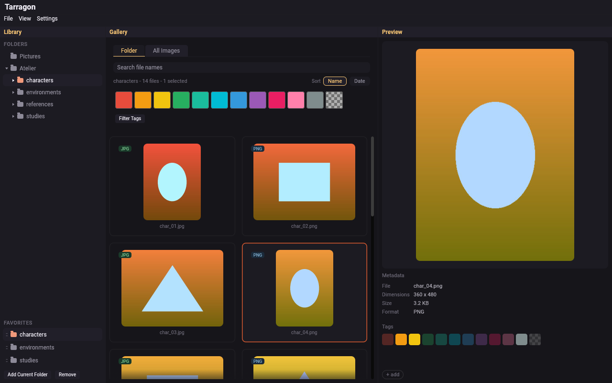
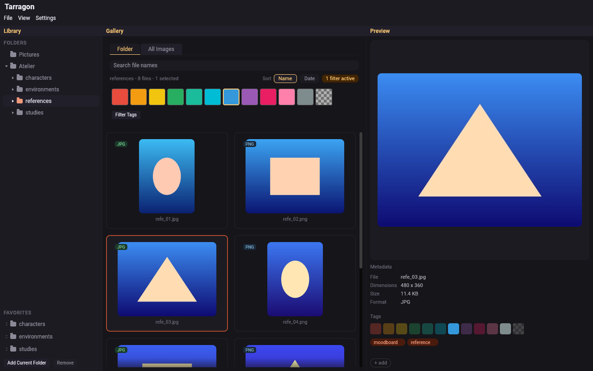
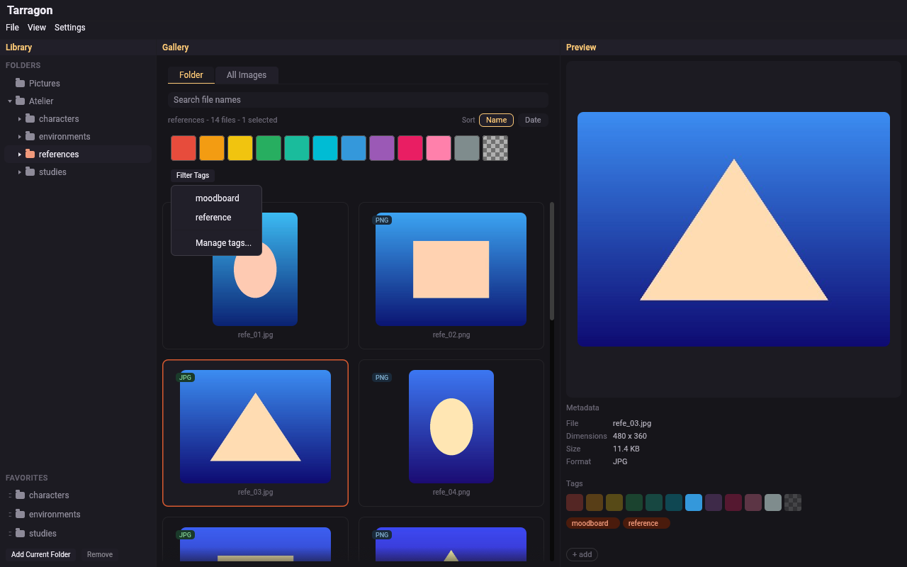
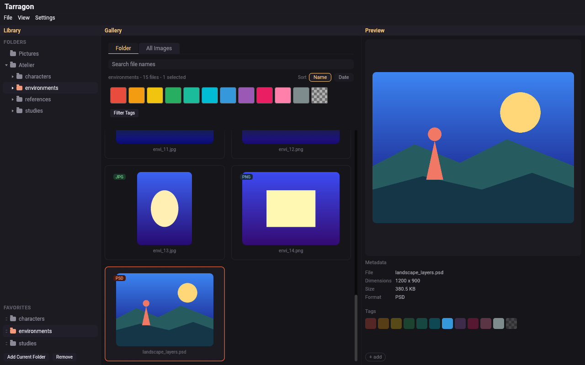
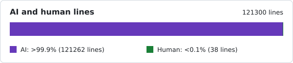

# Tarragon

**Browse thousands of images instantly, without moving a single file.**

Tarragon is a free image browser for artists who have too many reference
images, sketches, and PSD files. Point it at a folder and start browsing. No
importing. No copying. Your files stay where they are on your disk.

## Features

- **Thumbnails.** JPEG, PNG, WebP, TIFF, PSD, and PSB files, plus Krita (KRA)
  and Clip Studio (CLIP) files. Thumbnails are cached, so they load fast the
  second time.
- **PSD preview.** See layered PSD and PSB files in the Preview panel without
  opening Photoshop. The panel shows file name, size, and format.
- **Find by color.** Tarragon finds the dominant color of each image. Click a
  swatch to filter the folder.
- **Your own tags.** Add tags to any image and filter by them. Manage tags
  lets you rename or delete a tag.
- **Favorites.** Add a folder to the Favorites sidebar and open it in one
  click.
- **Open in your editor.** Tarragon opens the file with the app your system
  uses for that file type. Krita and GIMP are two examples.
- **File operations.** Rename, duplicate, copy, paste, and delete. Delete
  moves a file to the Trash, or you can choose Delete permanently.
- **Search and sort.** Search by file name. Sort by name or by date.
- **Dark theme.** Easy on the eyes for long sessions.

Copy and Paste in the grid work on Linux only for now.

## Screenshots









## Install (Linux)

Download `tarragon-0.2.0-linux-x86_64-portable.zip` and its `.sha256` file
from the [GitHub Releases](https://github.com/las-pinter/tarragon/releases)
page. Then run:

```sh
sha256sum -c tarragon-0.2.0-linux-x86_64-portable.zip.sha256
unzip tarragon-0.2.0-linux-x86_64-portable.zip
cd tarragon-0.2.0-linux-x86_64-portable
./tarragon
```

The `data/` folder in the zip turns on portable mode. Tarragon then keeps its
database in that folder, next to the program.

Tarragon needs a few system packages at run time. See
[Runtime packages](docs/build.md#runtime-packages) for the list.

Windows and macOS are not released yet.

## Quick start

1. Launch Tarragon. You see the Library, Gallery, and Preview panels.
2. Choose File, then Open Folder..., and pick a folder with images.
3. Browse. Click a thumbnail to preview it. Double-click to open it in your
   editor. Right-click for more actions.
4. Tag. Right-click an image and choose Add tag..., or use the + add button in
   the Preview panel.
5. Filter by color. Click a color swatch above the grid. Click it again to
   clear the filter.

To save a folder, select it and choose Add Current Folder under Favorites.

## Build from source

```sh
git clone https://github.com/las-pinter/tarragon.git
cd tarragon
cargo build --release
```

The binary is at `target/release/tarragon`. See [docs/build.md](docs/build.md)
for the toolchain and the other build steps.

## License

Tarragon is released under the MIT license. See [LICENSE](LICENSE).

## Attribution



Lines are counted with `git blame` over the tracked text files. A line is AI
when its commit heading starts with `ai:` (or the older `ai-`). Every other
line is human, and lines not yet committed count as human. Files under the
top-level `assets/` folder and binary files are left out. The command
`cargo xtask attribution` makes the chart. It is refreshed before each release.
